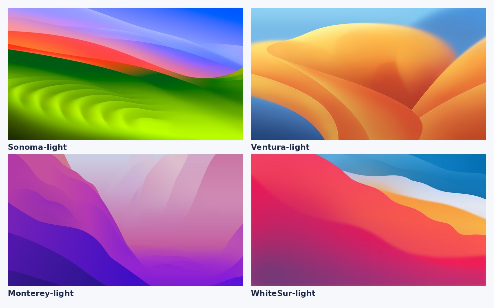
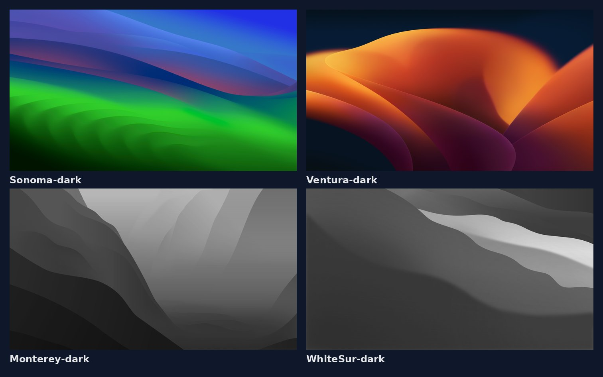
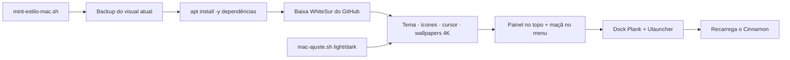

<p align="center">

</p>

<h1 align="center">Mint Estilo Mac</h1>
<p align="center"><i>Script que deixa o Linux Mint com visual de macOS, em modo claro ou escuro, com um único comando</i></p>

<p align="center">


</p>

## Sumário

- [Sobre](#sobre)
- [O que o script faz](#o-que-o-script-faz)
- [Modos claro e escuro](#modos-claro-e-escuro)
- [Como funciona](#como-funciona)
- [Como executar](#como-executar)
- [Personalização](#personalização)
- [Como voltar ao visual anterior](#como-voltar-ao-visual-anterior)
- [Estrutura do repositório](#estrutura-do-repositório)
- [Projetos irmãos](#projetos-irmãos)
- [Créditos](#créditos)
- [Autor](#autor)

## Sobre

Automação em **Bash** para transformar o Linux Mint (Cinnamon) em um desktop com cara de macOS, sem configurar nada na mão. O script baixa tudo dos projetos originais, aplica as configurações com `-y` e faz backup do visual atual antes de qualquer mudança.

Testado no **Linux Mint 22.3 "Zena" (Cinnamon)**.

## O que o script faz

| Recurso | Na prática | Ferramenta |
| --- | --- | --- |
| 🎨 Tema | Janelas, painel, ícones e cursor no estilo macOS | WhiteSur |
| 🧭 Barra de menus | Painel no topo, menu à esquerda, relógio e status à direita, translúcido | Cinnamon + Transparent Panels |
| 🍎 Maçã no menu | Troca o ícone do Mint pela maçã (preta no claro, branca no escuro) | WhiteSur |
| 🚀 Dock | Dock inferior centralizado, com zoom e ocultação inteligente | Plank |
| 🪟 Janelas | Botões fechar, minimizar e maximizar à esquerda | Cinnamon |
| 🔤 Fonte | Inter em toda a interface | fonts-inter |
| 🖼️ Papéis de parede | Coleção 4K (Sonoma, Ventura, Monterey e Big Sur) | WhiteSur Wallpapers |
| 🔍 Spotlight | Busca rápida com `Ctrl+Espaço` | Ulauncher |

## Modos claro e escuro

| | Claro (`light`) | Escuro (`dark`) |
| --- | --- | --- |
| Tema | WhiteSur-Light | WhiteSur-Dark |
| Barra de menus | Clara | Preta |
| Maçã no menu | Preta | Branca |
| Papel de parede padrão | Sonoma-light (4K) | Sonoma-dark (4K) |

**Papéis de parede claros**



**Papéis de parede escuros**



## Como funciona



## Como executar

```bash
git clone https://github.com/sauloprado/mint-estilo-mac.git
cd mint-estilo-mac
chmod +x *.sh

# instalação completa (modo claro, padrão)
./mint-estilo-mac.sh

# instalação completa no modo escuro
./mint-estilo-mac.sh dark
```

Depois de instalado, para **alternar entre claro e escuro**:

```bash
./mac-ajuste.sh light   # barra clara, maçã preta, wallpaper claro
./mac-ajuste.sh dark    # barra preta, maçã branca, wallpaper escuro
```

> Rode como seu usuário normal, **sem `sudo`**: o script pede a senha só quando precisa instalar pacotes.

## Personalização

As variáveis ficam no topo dos scripts:

| Variável | Padrão | Opções |
| --- | --- | --- |
| `PAPEL_LIGHT` | `Sonoma-light` | `Ventura-light`, `Monterey-light`, `WhiteSur-light` |
| `PAPEL_DARK` | `Sonoma-dark` | `Ventura-dark`, `Monterey-dark`, `WhiteSur-dark` |
| `INSTALAR_ULAUNCHER` | `1` | `0` para não instalar |
| `TAMANHO_ICONES_DOCK` | `48` | tamanho em pixels |
| `ALTURA_PAINEL` | `28` | altura da barra em pixels |

Todos os papéis de parede ficam em `~/Imagens/Wallpapers-Mac` para trocar quando quiser.

## Como voltar ao visual anterior

```bash
dconf load /org/cinnamon/ < ~/mac-look-backup/cinnamon.dconf
dconf load /net/launchpad/plank/ < ~/mac-look-backup/plank.dconf
```

## Estrutura do repositório

```text
mint-estilo-mac/
├── mint-estilo-mac.sh     # instalação completa (light | dark)
├── mac-ajuste.sh          # alterna entre claro e escuro
├── assets/
│   ├── capa.png
│   ├── wallpapers-light.jpg
│   └── wallpapers-dark.jpg
├── LICENSE
└── README.md
```

## Projetos irmãos

| Projeto | Distribuição | Desktop |
| --- | --- | --- |
| [mint-estilo-mac](https://github.com/sauloprado/mint-estilo-mac) | Linux Mint | Cinnamon |
| [ubuntu-estilo-mac](https://github.com/sauloprado/ubuntu-estilo-mac) | Ubuntu | GNOME |
| [fedora-estilo-mac](https://github.com/sauloprado/fedora-estilo-mac) | Fedora | GNOME |

## Créditos

Temas, ícones, cursor e papéis de parede são do projeto **WhiteSur**, de [vinceliuice](https://github.com/vinceliuice), e são baixados direto da fonte original durante a execução (nada disso é redistribuído aqui). Dock: [Plank](https://launchpad.net/plank). Busca: [Ulauncher](https://ulauncher.io). Painel translúcido: extensão *Transparent Panels* (Cinnamon Spices).

Projeto pessoal, sem vínculo com a Apple. macOS e o logotipo da maçã são marcas da Apple Inc.

## Autor

**Saulo Prado** · Analista de Sistemas · Gestão de Ativos de TI, orçamento, automação e dashboards

[](https://www.linkedin.com/in/saulo-prado-ab4a0b96/)
[](https://github.com/sauloprado)
